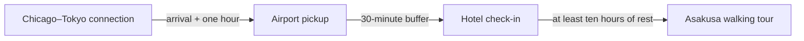

# Domino Rescue: TripRescue's connected recovery workflow

Implemented October 25, 2026. This is a working simulation, not a real booking integration.

An additional first phase now provides password-encrypted traveler settings and a separate **Real Travel Mode** at `/rescue/real` for entered existing tickets and manual airline/original-seller handoffs. Live rebooking remains unavailable. See [REAL_TRAVEL_INTEGRATION_PLAN.md](REAL_TRAVEL_INTEGRATION_PLAN.md) for researched provider capabilities, costs, access requirements, and remaining phases.

## What makes this a product feature

Pip helps explain travel choices. Domino Rescue has its own saved reservations, dependency graph, scheduling rules, finite mock flight inventory, approval step, execution engine, and history. The workflow works even with the AI server stopped. A language model does not decide permissions, mark bookings changed, or execute the repair.

## Run it

```powershell
Set-Location -LiteralPath "C:\Users\pobba\Downloads\Trip ahckathon"
powershell.exe -NoProfile -ExecutionPolicy Bypass -File .\start-triprescue.ps1 -OpenBrowser
```

Open [Domino Rescue](http://127.0.0.1:5173/rescue). Use your existing local profile, or create one when prompted. Choose **Open rescue demo → Simulate flight cancellation → Compare recovery options → Review this option**. Inspect the changes, check the approval box, and choose **Approve & apply simulated repair**.

The demo is a separate saved Tokyo trip for one fictional traveler, May 1–5, 2027, with a USD 3,000 budget. Creation adds four linked itinerary records and four explicitly simulated reservations. Opening an existing demo does not duplicate it. Choosing **Create fresh demo** deliberately adds another fictional trip without deleting the earlier one. Nothing is added to your other trips automatically.

## The chain reaction



Simulating cancellation marks the flight cancelled and reachable dependent reservations at risk. The linked arrival item is marked cancelled; it does not delete records. Graph traversal rejects cycles or connections outside the trip's reservation set and visits shared descendants only once. At risk means a plan needs review; a valid repair can preserve an existing time.

## The available mock options

All schedule times below are Tokyo local time (JST). Amounts are additional fictional estimates for this one-traveler demo, not quotes from an airline or venue.

| Strategy | Tokyo arrival | Tour | Additional cost |
| --- | --- | --- | --- |
| Fastest | May 1, 18:00 · three hours late | May 2, 10:00 · original time | USD 435 |
| Balanced | May 1, 23:00 · eight hours late | May 2, 13:00 · later the same day | USD 250 |
| Cheapest | May 2, 15:00 · one day late | May 3, 10:00 · following morning | USD 80 |

Additional costs include the mock flight change and any pickup, late-check-in, and tour-change fees. The original flight's planning value is carried into the replacement, rather than counted as a second flight purchase. There is no payment or refund processing. The three alternatives come from three finite fictional inventory entries; fewer entries produce fewer options.

Every candidate includes coordinated changes to flight, pickup, check-in, and tour. The backend checks the one-hour arrival buffer, 30-minute check-in buffer, rest period, trip dates, unrelated itinerary conflicts, and total saved budget. A candidate that fails date, overlap, or budget validation is shown as unavailable with a reason. This demo does not model real traffic, hotel availability, airline policies, or operating hours.

## Approval and failures

Comparison does not apply a repair. Approval requires the JSON boolean `true` and the owned saved plan ID. The server reloads the trip, checks ownership, checks the saved-state fingerprint, and validates the linked itinerary again under a SQLite write lock. Changes to dates, budget, itinerary, reservations, or dependency edges make an older plan stale.

Successful mock execution updates reservation schedules, statuses, estimates, and linked itinerary records, resolves the disruption, invalidates other pending choices, and records approval and each executed action. Refreshing or restarting the backend preserves those changes. Repeated or concurrent approval cannot execute the same batch twice.

Expand **Try the provider-failure demonstration** during review and select its checkbox to force a mock pickup-provider failure. The attempted repair batch is rolled back: the cancelled flight and at-risk reservations stay as they were. The failed attempt and approval remain in the audit log. Another pending option can then be approved. An already-attempted failed option is not executed again by repeating its request.

## Pip's role

Choose **Explain it with Pip** to select the demo trip and prepare a question. Send it when ready. Pip receives a bounded, owned, read-only snapshot of reservation status and recovery tradeoffs. It receives no profile token, provider key, unrelated trip, or recovery-execution tool. Chat also links back to the rescue workspace.

The real local-model explanation check exposed factual mistakes, including confusing balanced and cheapest timings. The structured schedules, estimates, validation messages, and execution history in the workspace are the authoritative application result. No chat response approves a repair.

## New files and database tables

| Location | Responsibility |
| --- | --- |
| `backend/app/services/rescue.py` | Graph traversal, mock inventory, constraints, persistence, approval, execution, and audit. |
| `backend/app/api/rescue.py` | Owned demo, read, cancellation, comparison, and approval endpoints. |
| `backend/app/models.py` | Five additional persisted recovery entities. |
| `backend/alembic/versions/0003_domino_rescue.py` | Additive migration; no table rebuild, seed data, or destructive downgrade. |
| `backend/tests/test_rescue.py` | Recovery, ownership, freshness, concurrency, failures, and Pip-context checks. |
| `backend/tests/test_migrations.py` | Schema compatibility and preservation of existing rows. |
| `frontend/src/features/rescue/` | Typed API calls, dependency-chain view, comparison, review, and audit UI. |

New tables: `reservations`, `reservation_dependencies`, `disruption_events`, `recovery_plans`, `rescue_audit_logs`. Existing profiles, trips, itinerary items, and proposals remain unchanged by the migration. A linked itinerary item can still be removed through its existing form; the reservation link becomes empty, and recovery refuses to silently recreate or overwrite it.

## Verification

The full backend suite passed 351 tests. The frontend production build passed. Eight browser flow checks passed against a separate QA database, covering explicit creation, cancellation, options, approval, atomic failure, successful persistence, Pip navigation, fresh demos, and trip navigation. Seven accessibility scans at 1440, 1024, 768, 390, and 320 pixels detected no violations. No browser JavaScript errors were reported.

Evidence: `.artifacts/domino-rescue/browser-results.json` and associated screenshots. A real local-model explanation also ran through an isolated app/database; its text and timing are in `local-chat-results.json`. That is a response-handling test, not a guarantee of factual model accuracy. All QA-created records stayed in isolated databases.

The application database was backed up to `.artifacts/domino-rescue/before-migration.db`. Existing rows were compared before and after: two profiles, three trips, sixteen activities, and two proposals were unchanged. No demo was inserted into the user's real database during implementation.

## Limits and the next phase

Only the connected fictional flight-cancellation scenario is implemented. There is no live cancellation detection, arbitrary reservation import, airline integration, purchase, refund, real rebooking, missed-connection recovery, hotel cancellation recovery, or automated recovery approval. It introduces no additional API key or application dependency.

The connected demo retains this scope. The separate private-settings/assisted-travel phase does not turn simulated repairs into real bookings.

## Subsequent account update

Username/password sign-in now links existing profiles and their saved recovery records without changing owner IDs. The original verification counts above describe the recovery phase; the later full suite passed 396 tests. See [ACCOUNT_SECURITY.md](ACCOUNT_SECURITY.md) for account setup, data preservation, and current checks. Real booking capabilities remain unchanged.
