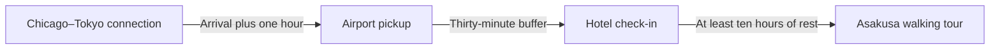
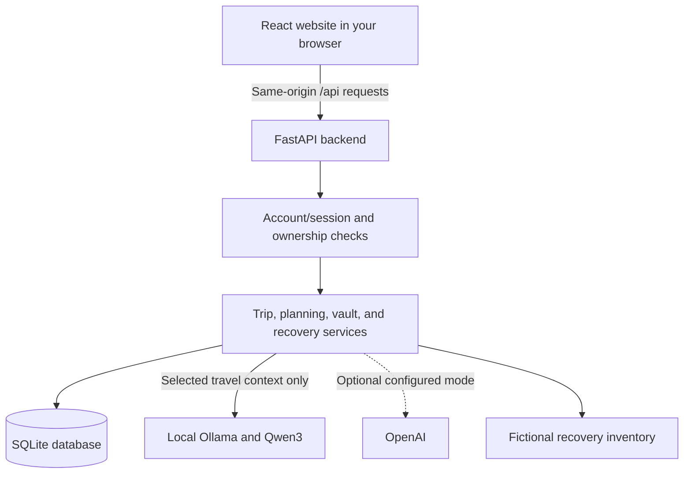

# Wayva: what the updated application does

The application has been rebranded from TripRescue to **Wayva**, with the tagline **Your journey, reimagined.** The assistant is now **Way** (formerly Pip). The website uses a forest-green compass logo with a curved W route and teal accents. Historical feature descriptions below use the former names. Existing accounts, saved data, storage keys, API paths, document filenames, and startup commands remain compatible; this rebrand requires no database migration.

Status snapshot: October 25, 2026.

This document describes the existing implementation after the saved-trip, daily planning, natural-conversation, free local AI, visual-design, Domino Rescue, private traveler settings, and username/password account updates. It separates implemented behavior from the larger product vision in [PROJECT_SPEC.md](PROJECT_SPEC.md). It is a status report, not an instruction to begin another development phase.

For dependency installation and additional setup details, see [README.md](README.md).

This is the main guide to what the application currently does. Start with the overview and feature table, then use these links for more detail:

- [Current capabilities](#3-what-users-can-do-now) and [the six-feature comparison](#4-where-the-six-finalized-features-stand).
- [Planning and approval](#7-how-a-live-conversation-works-behind-the-scenes), [budgets](#9-budgets-and-scheduling-practical-details), and [storage](#10-what-the-app-remembers-and-where).
- [Pages](#13-pages-and-navigation), [technology](#14-technical-stack), [database](#16-database-structure-and-preservation), and [APIs](#17-existing-api-endpoints).
- [Windows startup](#18-start-the-website-on-this-windows-computer), [AI configuration](#19-select-free-local-ai-or-optional-cloud-ai), and [actual verification](#20-what-was-actually-tested).
- [Accounts in detail](#24-accounts-and-their-data-step-by-step), [private traveler details](#25-private-traveler-settings-in-detail), and [Domino Rescue in detail](#26-domino-rescue-from-cancellation-to-repair).
- [How the parts connect](#27-how-the-website-backend-database-and-ai-connect), [things to ask Pip](#28-practical-things-to-ask-pip), [troubleshooting](#29-common-problems-and-what-to-do), and [a hackathon demonstration](#30-a-clear-hackathon-demonstration).

Detailed companion documents: [account security and setup](ACCOUNT_SECURITY.md), [Domino Rescue](DOMINO_RESCUE.md), and [the future real-travel integration plan](REAL_TRAVEL_INTEGRATION_PLAN.md).

The subsequent full-product audit is documented in [PRODUCT_AUDIT_REPORT.md](PRODUCT_AUDIT_REPORT.md), including confirmed bugs, fixes, commands, real versus mocked AI evidence, data preservation, and production-readiness limits.

## 1. The application in plain language

TripRescue is a travel planning website centered around Pip, a floating companion that opens a chat window when clicked.

The intended experience is to explain your travel plans naturally, discuss ideas, refine a schedule, review the result, and save the activities you approve. The website keeps the trip's dates, destination, traveler count, budget, and saved activities together.

Pip appears inside the TripRescue website. It does not float over other computer applications. Conversation currently uses typing; microphone and voice conversation are not implemented.

The current project is a working local application with username/password accounts, saved trips, reviewed itinerary proposals, encrypted private traveler details, and a connected simulated booking-recovery workflow. It is not yet the complete six-feature application described in the specification.

For example, you can sign in, open a saved Tokyo trip, ask Pip for sightseeing and meal suggestions, refine the draft, and approve the additions. Separately, you can demonstrate how a cancelled fictional flight affects pickup, hotel check-in, and a tour, then approve a coordinated simulated repair. Entering your real ticket details opens a manual assistance workflow; it does not make the simulation act on that ticket.

## 2. What the latest updates changed

### Product-quality and security audit

Local reference-backed planning now uses a semantic intent decision followed by AI ranking of reviewed place IDs. The backend selects distinct sights, preserves saved schedule blocks, arranges time slots, applies requested supported daily windows and conservative buffers, and calculates transparent whole-group spending allowances. A partial draft revision preserves other dates. Strict city-only drafts require reference coverage; unknown places are not presented as verified businesses.

The proposal review includes **Place checks, costs & assumptions**, category amounts, group/per-person allowances, reference links, and exclusions. The source index is small and manually maintained, chiefly for Tokyo plus limited Kyoto identities; it is not live maps, current menus, hours, routes, or availability. Standard ranked-plan envelopes allocate 10% of remaining saved budget across proposed sights and 20% across meals; explicitly cheaper envelopes use 5% and 10%. These are allowances, not venue quotes or currency conversions.

The audit also fixed session revocation during AI generation, inclusive date boundaries, a vault-password input bound, oversized API bodies, local-inference concurrency, daily-count parsing, stale account copy, and three contrast issues. Patched FastAPI/Starlette/pytest packages replaced versions flagged by dependency scans. No schema migration or data reset was needed. See the audit report for the exact scope and remaining limitations.

### Username-and-password accounts

`/account` now supports registration, sign-in/out, and password changes. Existing local profiles can be explicitly linked using their current access token; the owner ID and all its saved records remain the same. New accounts receive a separate owner and trip collection. The original token is retired on linking. An unlinked local profile is preserved for explicit reopening if its browser signs into another account.

Passwords are salted Argon2id hashes. HttpOnly cookie sessions use backend ownership checks and session-specific request proof, expire after thirty idle minutes or eight hours total, and are rotated on sign-in/password changes. Password changes end other sessions. The vault keeps its separate encryption password. No account is seeded automatically; choose your own credentials. Recovery, MFA, public hosting, and permanent chat history remain unfinished. See [ACCOUNT_SECURITY.md](ACCOUNT_SECURITY.md) for the guide and verified behavior.

### Private traveler settings and assisted Real Travel Mode

Settings now includes a separate password-encrypted vault for optional traveler contact details and tickets purchased from an airline or other seller. Entries remain user-entered and unverified. The vault supports saving/editing/removing entries, lock/unlock, fifteen-minute unlock expiry, and password rotation. New private payloads are encrypted with a password-derived key, owner-bound, and excluded from automatic Pip context and application browser storage. Private validation errors do not echo submitted passwords or data. The password is not stored, and there is no forgotten-password recovery.

`/rescue/real` is a separate assisted workflow. It reports unavailable live capabilities, lets an unlocked owner select entered flight details, and prepares an original-seller handoff with official airline links. No personal details are placed in those URLs or submitted to a provider. No live provider is connected, and no booking is represented as confirmed. Basic account authentication now exists. Production hardening, recovery, provider authority, payment, and reconciliation remain prerequisites for real rebooking.

The sourced provider/cost comparison and staged architecture are in [REAL_TRAVEL_INTEGRATION_PLAN.md](REAL_TRAVEL_INTEGRATION_PLAN.md). That plan addresses existing tickets, uncertain purchase outcomes, partial external failures, and confirmed versus proposed dependent changes. No paid provider calls or public deployment were made.

### Domino Rescue: a connected recovery engine

Open `/rescue` to create or reopen a separate fictional Tokyo demo trip. Simulate the cancellation of its Chicago connection, inspect the dependency chain to pickup, hotel check-in, and walking tour, compare three mock recovery strategies, and explicitly approve a coordinated repair.

The backend checks trip dates, saved itinerary conflicts, budgets, arrival/check-in buffers, and rest before the tour. Approved mock changes update reservations and linked itinerary records, resolve the disruption, and record an audit trail. Duplicate approval does not execute twice. A provider-failure demonstration rolls back repair changes and records the failure instead of claiming success.

The feature has its own visual workspace and deterministic backend engine; no model or API key is needed for the recovery flow. Pip can explain an owned, read-only snapshot and link back to the workspace. Model explanations can still make factual errors; review the structured schedules and costs before approving. All reservations, availability, and fees are fictional. There is no real flight monitoring or rebooking. See [DOMINO_RESCUE.md](DOMINO_RESCUE.md).

### Free local AI without an API key

The selected provider is now Ollama running `qwen3:4b-q4_K_M` on this computer. It supports general conversation, selected-trip context, reviewed itinerary proposals, and structured direct generation. No API key, cloud AI account, or per-request inference charge is required for local mode. The downloaded model uses the computer's hardware; quality and speed are not guaranteed to match large hosted assistants.

Ollama is bound to `127.0.0.1:11434`, its cloud features are disabled by the launcher, and the application's adapter rejects remote server addresses and cloud model suffixes. It does not send local-mode requests to OpenAI as a fallback.

The official runtime and model have been downloaded into the project's ignored `.tools` folder. The model download is about 2.6 GB. The computer has an NVIDIA RTX 4060 Laptop GPU that Ollama detected for inference. The model still needs to be running whenever Pip is used in local AI mode.

### Updated visual design

The website keeps its cream-and-forest-green identity but now includes a contour-map background, warmer paper surfaces, terracotta accents, a framed destination photograph, travel-journal details, a dark-green journey section, and refined navigation/workspace cards. The background is decorative rather than a live map or verified route.

Existing navigation, forms, saved trips, and Pip remain in place. Domino Rescue has a working simulation; group tools and real booking integrations remain unfinished.

### Natural conversation in live AI mode

Previously, the backend used matching words and phrases to decide whether a message requested an itinerary. That could turn an informal request into an unrelated trip summary.

For live AI conversation about a selected trip, the model now interprets the conversation and decides between two responses:

- A normal conversational answer, such as explaining a restaurant suggestion.
- A structured itinerary proposal that the backend validates before displaying it for review.

Users should not need special command wording. Follow-ups can refer to the conversation and current unsaved draft, for example:

> That dinner seems expensive. Somewhere cheaper and quieter instead?

> Why did you choose that place?

> Keep the food stops, but give us less walking.

These are examples, not required commands. Actual interpretation depends on the live model; automated tests use controlled provider responses to verify the application's handling of those decisions.

The offline demo remains rule-based and limited. It does not become a general AI model because the live conversation code exists.

### Fuller daily plans

The planning flow supports requests for multiple sightseeing stops plus named lunch and dinner places each day. Existing saved sightseeing activities count toward the requested daily coverage. Meals are separate from sightseeing.

For example, if a day already has one saved walk and the traveler requests two sightseeing activities plus lunch and dinner, a proposal can add another activity and the two meals while preserving the saved walk.

The backend checks dates, times, conflicts, costs, and requested daily coverage. For whole-trip meal requirements, lunch must fit between 11:00 and 15:00 and dinner between 17:00 and 22:00. A single lunchtime food item cannot satisfy both meals. Requested meal suggestions need a location more specific than just the destination city.

For indexed local planning, AI ranks referenced places and the backend selects and schedules them; outside that coverage, model-generated suggestions remain unverified. Offline examples use a small curated Tokyo/Kyoto catalog and are explicitly labeled as demonstrations. None of these paths verifies future opening hours, availability, menu prices, or precise travel times.

### Revisions to unsaved drafts

Pip receives the latest owned pending draft that still matches the current saved trip. It can propose a complete revised version of those unsaved additions.

After a valid revision is stored, earlier pending drafts for the same trip and matching saved-trip snapshot are marked as replaced. The UI labels them "Replaced by newer draft," and the backend refuses to approve them.

Replacing a draft does not change the saved itinerary. Changing or removing an activity that is already saved still requires the itinerary's manual controls.

### Chat continuity

Conversation and unsent text are kept in the current browser tab's session storage (`sessionStorage`), with separate threads for each local profile and selected trip. General travel chat has a separate thread too.

Refreshing or switching trips restores the corresponding thread. New chat clears the current thread and keeps it clear after refresh. It does not delete a trip or reject a pending proposal on the server.

## 3. What users can do now

| Area | Implemented behavior |
| --- | --- |
| Account/profile | Register, sign in/out, change password, link an existing local profile, and rename the display name in Settings. |
| Saved trips | Create and list trips; view and edit destination, departure location, dates, traveler count, budget, currency, and status. |
| Itinerary | Add, edit, reschedule, cancel, or remove individual activities through forms. |
| Budget | See planned activity estimates and the remaining trip budget. |
| Dashboard | See saved current/upcoming trips and the next relevant planned activity by date. |
| Pip | Open typed chat, ask travel questions, use a selected trip's facts, and discuss a current draft. |
| AI proposals | Request itinerary additions, inspect daily schedules and estimates, refine an unsaved draft, and approve or reject it. |
| Domino Rescue | Create a separate fictional trip, simulate its flight cancellation, inspect dependent reservations, compare repairs, and approve a simulated change with saved history. |
| Private traveler settings | Save encrypted contact and existing-flight details behind a separate vault password; unlock, edit, lock, or change that password. |
| Real Travel assistance | Select owned entered ticket details and prepare a manual original-seller handoff; see which live capabilities are unavailable. |
| Persistence | Accounts, trips, activities, proposals, simulated recovery state, and encrypted private records survive refreshing the website or restarting the servers. |
| Responsive layout | Browse the website and use the chat on desktop and mobile layouts. |
| Connection feedback | See backend connection checks, loading states, retry controls, and actionable errors. |

An itinerary activity can be an activity, food stop, transport item, accommodation item, or other planning item. These categories do not represent real reservations.

There is no trip deletion endpoint or trip deletion control in the current implementation. Individual itinerary items can be removed.

## 4. Where the six finalized features stand

| Feature | Intended complete behavior | Current status |
| --- | --- | --- |
| Dream-to-Trip | Discover destinations, interpret a natural travel request, create a whole trip, generate daily plans, and save approved results. | Partially implemented: planning proposals for an existing saved trip work at the application level. A complete conversation-to-new-trip creation and destination-selection workflow is unfinished. General destination brainstorming is possible in live conversation. |
| Travel Buddy with Memory | Converse naturally and retain editable, explicitly saved preferences across future trips. | Partially implemented: selected-trip context, recent conversation, current-draft context, and tab-scoped chat continuity exist. Persistent preference records and memory controls are unfinished. |
| Domino Rescue | Analyze dependencies after a disruption, compare recovery strategies, execute approved supported/mock changes, and record an audit trail. | Working flight-cancellation demonstration on a separate persisted fictional trip: dependency graph, three mock inventory options, schedule/budget checks, approval, atomic execution, itinerary updates, duplicate protection, and audit. Other disruption types and real providers remain unfinished. |
| SideQuest | Generate a time-, location-, and budget-constrained mini-adventure with a practical route and approval workflow. | Dedicated workflow, maps, and location integration are unfinished. Pip can discuss ideas or propose compatible itinerary additions. |
| Group Harmony | Manage members, combine preferences, calculate explainable fairness scores, and propose a balanced shared plan. | Not implemented as a connected group-management and scoring workflow. |
| SplitQuest | Assign subgroups, create separate schedules, calculate a feasible reunion, and save distinguishable subgroup activities. | Not implemented as a connected subgroup planning workflow. |

The landing-page choices introduce the vision. Domino Rescue opens its connected simulation; other choices offer conversation starters. Their presence does not mean all six connected tools have been implemented.

## 5. A realistic current user journey

1. Open the local TripRescue website.
2. Create an account or sign in. When linking the current local profile, keep its saved-data option selected.
3. Create a trip with its destination, dates, travelers, budget, and currency.
4. Open that trip or select it in Pip's Plan for menu.
5. Explain the kind of schedule, food, and pace you want.
6. Review Pip's proposed additions and their estimated costs.
7. Ask follow-up questions or request changes to the unsaved draft.
8. Choose Approve and save when satisfied, or reject the proposal.
9. View the saved activities in the chronological trip itinerary.
10. Use the existing activity forms for later changes to already-saved items.

Example request:

> Use my saved trip's dates and budget. Plan multiple interesting places each day, with lunch and dinner nearby. Leave time to travel and relax, and keep my existing activities.

Pip can use facts already stored for the selected trip. A new saved trip still needs to be created through the trip form; the chat cannot create that entire record automatically yet.

## 6. Advice, drafts, saved plans, and bookings

| Term | Meaning in this application |
| --- | --- |
| Conversational advice | Text about a travel question or idea. It does not change itinerary records. |
| Proposal/draft | Suggested activities stored separately for review. They are not yet saved itinerary activities. |
| Saved itinerary | Planning records added through forms or an approved proposal. |
| Estimate | A planning amount or timing assumption, not a verified quote or route. |
| Reservation/booking | A real provider-confirmed transaction. The current application does not create these. |
| Simulated reservation | A fictional booking record used by Domino Rescue; it never represents an actual ticket or hotel reservation. |
| Entered flight details | Information you saved about a ticket purchased elsewhere; the application has not verified it with an airline. |
| Assisted handoff | Instructions and a fixed official airline link for manually contacting the original provider. |
| Demo | A controlled offline example, explicitly distinguished from live AI. |

Approving a proposal saves activities inside TripRescue. It does not reserve a restaurant, buy a ticket, book a flight, or contact a hotel.

## 7. How a live conversation works behind the scenes

```text
You send a message in Pip
          |
          v
React sends recent conversation and the selected trip ID to FastAPI
          |
          v
Backend checks the account/profile and trip ownership
          |
          v
Backend prepares saved-trip facts and a current valid unsaved draft
          |
          v
Selected AI model returns an answer OR a structured itinerary proposal
          |
          +---- Normal text: show the answer without changing the itinerary
          |
          +---- Proposal: validate the plan and store a pending review
                                    |
                                    v
                         You approve or reject it
                                    |
                                    v
                   Backend rechecks and saves approved activities
```

The model chooses whether the conversation calls for an answer or a draft. For a selected trip with reference coverage, local Ollama first makes a compact semantic intent decision, then returns an ordinary answer or structured place rankings. Planning intent requires actual ranking data, not prose saying that a draft is ready. The backend selects distinct positively ranked sights, assigns dates/visit slots, preserves fixed saved blocks, and calculates spending envelopes before running the full validation and proposal-storage workflow. For partial revisions, unchanged draft dates are retained.

The local adapter also retains validated full-plan response handling for compatibility and destinations without indexed coverage; those places are unverified. Optional OpenAI mode uses one function tool, `propose_itinerary`, with automatic tool choice. An ordinary question is not forced into a planning action. No provider path can approve its own proposal.

The model does not receive a general database connection, arbitrary function execution, an approval tool, a deletion tool, or booking tools. The backend, rather than the model, controls permissions and writes.

General travel chat without a selected trip uses a text conversation path and does not expose the saved-trip proposal tool. The direct proposal API also remains available separately from conversational tool selection.

## 8. What happens before a proposal is saved or approved

The backend validates that:

- The profile owns the selected trip and proposal.
- Generated data matches the expected structured format.
- Activities have valid text, dates, local start/end times, categories, and decimal costs.
- Every suggested date is within the saved trip dates.
- Each activity ends after it starts on the same date.
- Planned additions do not overlap saved planned activities or one another.
- Existing planned costs plus proposed additions fit the trip budget.
- Requested daily coverage is satisfied when whole-trip daily requirements apply.
- The saved trip has not changed while the AI was preparing a proposal.
- A revised draft still replaces a current pending version.

For local AI, semantically invalid planning data receives specific validation feedback and up to two automatic correction attempts using the same model. The initial daily requirements and backend restrictions remain in force. An overall 240-second limit bounds the work. Invalid response schemas and unexpected actions are rejected; invalid plans are not stored as successful proposals. Local calls now use non-reasoning output to reserve tokens for useful structured data rather than long hidden reasoning.

New AI drafts also check supported explicit daily windows, requested full-trip date coverage, reference-city/area contradictions, visit-duration bounds, and transfer/rest buffers. Indexed ranked plans avoid repeated sights unless revisits are explicitly allowed. Legacy/full-plan repeated places are flagged and rejected when the traveler explicitly requests no repeats. New stored quality constraints are checked again at approval. Existing proposals without quality metadata remain readable and still use their original date/overlap/budget/freshness checks.

Approval checks the saved-trip snapshot again. If dates, budget, or activities changed after generation, the proposal becomes out of date and cannot simply be applied.

Approval is protected against duplicate execution. Approving an already-approved proposal returns its result without inserting the activities again. Rejection leaves the itinerary unchanged; rejecting an approved proposal cannot undo saved activities.

In storage, a replaced draft uses the existing rejected status plus a `superseded_by` value in its JSON payload. This update did not require a new database table or a destructive migration.

## 9. Budgets and scheduling: practical details

- The budget belongs to the whole trip, not automatically to each traveler.
- AI activity and meal estimates are intended to cover the whole group in the trip's currency.
- Supported currencies are USD, EUR, GBP, JPY, CAD, AUD, and INR.
- Cancelled itinerary items remain stored, but are excluded from planned spending and scheduling conflicts.
- Manually entered activities can take the estimate above the budget; the remaining balance can be negative. Proposal generation/approval enforces the available budget for suggested additions.
- Currency cannot be changed while itinerary items exist, preventing existing amounts from being silently relabeled.
- Editing trip dates is rejected if it would leave an existing itinerary item outside the trip.
- Times are local to the destination. There is no verified transport routing or complete timezone-aware travel engine.
- The dashboard selects its next relevant activity by date; it does not claim precise cross-timezone real-time tracking.

## 10. What the app remembers and where

| Data | Storage | Important behavior |
| --- | --- | --- |
| Profiles | SQLite | Includes display name and a hash of the private profile token. |
| Account access | HttpOnly cookie plus in-memory session proof | SQLite stores the cookie hash and session expiry; passwords are salted Argon2id hashes. |
| Unlinked legacy profile token | Browser local storage | Still opens an unclaimed local profile; retired when explicitly linked to an account. |
| Trips and itinerary items | SQLite | Persist across page refreshes and server restarts. |
| Proposal drafts and approval status | SQLite | Remain separate from itinerary activities until approved. |
| Simulated reservations, disruptions, repairs, and history | SQLite | Persist as owned demo records; they are separate from real entered tickets. |
| Private traveler/ticket payload | Encrypted in SQLite | Requires its separate vault password; no automatic sharing with Pip. |
| Vault unlock key | Backend process memory | Short-lived; locking, expiry, or restarting the backend requires unlocking again. |
| Selected trip | Browser local storage | Helps reopen the selected trip context. |
| Chat threads and unsent text | Browser session storage | Scoped to this tab, profile, and trip; not a permanent cross-device conversation history. |
| Optional cloud API key | Ignored backend `.env` file | Used only for optional OpenAI mode; local Ollama needs no API key. |
| Local model weights | `.tools/ollama-models` | Downloaded once; loaded by Ollama for local inference. |
| Long-term travel preferences | Not implemented | Preferences can influence the supplied conversation without becoming permanent profile memory. |

Username/password sign-in reopens account-owned records on this same server even from another browser. Clearing local storage does not delete those records. Unlinked legacy profiles still depend on their original browser token. There is no email password-reset service, lost-token recovery, public hosting, or cloud sync. Signing out clears the browser's displayed trip/chat state; permanent account chat history is unfinished.

New chat clears the current transcript and unsent text. It does not delete saved trip data or reject a pending backend draft. Session storage has a bounded cache, and older conversation may be dropped. If session storage is unavailable or corrupt, the app falls back to usable chat without restoring that cached history.

The application does not add account passwords, authentication cookies, session proofs, profile access tokens, provider keys, or private vault contents to AI trip context. Do not paste credentials into Pip. Information you type into a message becomes conversation content and is sent to the selected AI provider when that message is sent.

## 11. Current limits

| Limit | Current value/behavior |
| --- | --- |
| AI-generated trip coverage | Up to 21 days per generation. |
| Proposed additions | Up to 120 per proposal. |
| User chat message | Up to 2,000 characters. |
| Backend chat request | Up to 20 messages and 12,000 content characters; final message must be from the user. |
| Browser context sent per turn | Recent messages are trimmed to fit the backend bounds; the full cached thread is not all sent each time. |
| Live saved-trip scheduling context | Up to 200 planned activities. A truncated schedule can be discussed, but the planning tool is disabled. |
| Demo factual trip context | Up to 30 planned activities. |
| Restorable chat | Up to 40 messages per thread and 12 recent threads, with additional size limits. |
| Restored pending reviews | Up to three recent pending proposals can be appended when restoring a thread, unless New chat suppressed that restoration. |
| Planning provider timeout | At most 180 seconds per Ollama call, within a 240-second overall planning/correction budget; 150 seconds for OpenAI. |
| Selected-trip browser request timeout | 300 seconds for Ollama; 180 seconds for OpenAI. |
| Local context window | General text defaults to 8,192 tokens; selected-trip structured turns use at least 16,384. Large histories and long plans still have practical limits. |
| API request size | At most 128 KiB, including streamed JSON bodies. |
| Concurrent local inference | One model request per backend process; additional requests receive a retryable busy error. |
| Account username | 3–30 characters; case-insensitive letters/numbers with dots, underscores, or hyphens; starts with a letter or number. |
| New account password | 15–128 characters, with confirmation in the website form. |
| Account session | Thirty minutes without owned API activity, with an eight-hour absolute lifetime. |
| Failed sign-in cooldown | Five failed attempts for the same username/client-address combination trigger a fifteen-minute cooldown. |
| Vault password | 12–128 characters; separate from the account password. |
| Vault unlock | Expires within fifteen minutes; not a permanent signed-in state. |
| Entered flight details | At most twenty entries in the private vault. |

These are application safeguards, not a claim that a provider will always return a successful response within the limit.

## 12. Local AI, optional cloud AI, and the offline demo

**Local AI (selected)** uses Ollama's native `/api/chat` endpoint on this computer. The default model is `qwen3:4b-q4_K_M`; `OLLAMA_MODEL` can select another installed local model. Conversation and proposal generation need no API key. The launcher disables cloud features and the backend sends no authentication headers or remote fallback requests. Local generation uses GPU/memory resources and may need shorter requests for long schedules.

**Optional OpenAI mode** remains available through the backend. Its code default is `gpt-5.4-mini`; `OPENAI_MODEL` can override it. It requires a valid credential and provider account access. Those requests ask for `store: false`, and the selected travel context is sent to OpenAI. An existing cloud key is preserved when selecting local AI but is not used by local-mode calls.

**Demo mode** requires no paid AI key. It offers deterministic guidance and a limited curated Tokyo/Kyoto itinerary example. Daily demo schedules can include named venues, illustrative meal allowances, and official venue references. It cannot provide unlimited personalized reasoning, live search, or verified future availability. The small catalog can repeat places on longer trips.

A failed AI request does not silently switch to demo mode or another provider. A missing local server/model, provider errors, invalid structured responses, and timeouts are shown as errors rather than claimed successes.

At the time this document was written, the local configuration endpoint reported:

```json
{"mode":"ollama","ai_ready":true,"setup_required":false}
```

For Ollama, `ai_ready` checks that the local server answers and lists the selected model. It does not itself prove generation quality. In optional OpenAI mode, readiness still checks the configured key's presence rather than authenticating it. The earlier OpenAI authentication attempt returned `invalid_api_key`; that credential is not required for the selected local provider. Actual local conversation and a one-day itinerary approval flow have now passed separate real-model checks; see the verification section.

## 13. Pages and navigation

| Address | Purpose |
| --- | --- |
| `/` | Branded landing page, six-feature overview, My Trips navigation, and Pip entry points. |
| `/dashboard` | Saved-trip overview and date-based activity information. |
| `/account` | Registration, sign-in/out, explicit old-profile linking, and account password changes. |
| `/trips` | Account entry, trip list, and trip creation. |
| `/trips/:tripId` | Trip details, budget picture, and chronological editable itinerary. |
| `/rescue` | Explicit entry into the fictional Domino Rescue demonstration. |
| `/trips/:tripId/rescue` | Owned reservations, dependency graph, cancellation, recovery choices, approval, and audit. Trips without demo reservations offer a separate demo. |
| `/buddy` | Introduction to Pip and a chat entry point. |
| `/explore` | SideQuest preview; dedicated connected tools are coming later. |
| `/groups` | Group Harmony/SplitQuest preview; group tools are coming later. |
| `/settings` | Account summary, profile rename, private traveler vault, and backend connection information. |
| `/settings#private-traveler` | Password-encrypted contact and existing-flight details; separate from the local profile's display name. |
| `/rescue/real` | Separate assisted Real Travel Mode, capability status, and original-seller handoff; no live rebooking. |

Pip remains accessible across the website. Unknown addresses have a recovery page. The website has desktop/mobile navigation; the My Trips link is visible from the landing experience.

## 14. Technical stack

| Part | Technology | What it does |
| --- | --- | --- |
| Frontend | React, TypeScript, Vite | Renders the website and manages interactive state. |
| Styling | Tailwind CSS and application CSS | Provides the visual theme and responsive layouts. |
| UI helpers | shadcn-style components, Radix Slot, Lucide icons | Reusable controls and icons. |
| Routing | React Router | Switches between the site's pages. |
| Backend | Python and FastAPI | Receives requests, validates input, and runs application rules. |
| Validation/configuration | Pydantic and pydantic-settings | Validates structured input/output and reads environment settings. |
| Database layer | SQLAlchemy and SQLite | Stores accounts, owners, trips, proposals, simulated recovery records, encrypted private payloads, and audit metadata. |
| Password hashing and encryption | Python cryptography: Argon2id and Fernet | Hashes account passwords and derives a separate key for the encrypted traveler vault. |
| Migrations | Alembic | Adds schema changes while preserving existing records. |
| Provider communication | HTTPX | Makes server-side AI requests. |
| Local AI runtime | Ollama with Qwen3 | Generates local responses without a paid API key. |
| Backend tests | Pytest | Runs isolated application tests. |
| Browser verification | Playwright tooling under `.tools` | Exercises the UI against isolated test data. |

Actual dependency pins are in `frontend/package.json`, `frontend/package-lock.json`, `backend/requirements.txt`, and `backend/requirements-dev.txt`. A portable Node runtime and Python virtual environment have already been installed locally; these generated tools are not application source.

## 15. Important files and folders

| Location | Responsibility |
| --- | --- |
| `PROJECT_SPEC.md` | Full intended product and phased development requirements. |
| `README.md` | Installation, startup, API, and troubleshooting instructions. |
| `frontend/src/App.tsx` | Main routes, landing page, navigation, and workspace pages. |
| `frontend/src/index.css` | Shared visual theme and responsive styling. |
| `frontend/src/components/buddy/floating-buddy.tsx` | Pip avatar, chat panel, transcript, request handling, and context switching. |
| `frontend/src/lib/buddy-api.ts` | Browser calls to the chat/configuration APIs. |
| `frontend/src/lib/buddy-session.ts` | Bounded, validated tab-scoped conversation storage. |
| `frontend/src/features/accounts/` | Account API client, registration/sign-in, password changes, and account UI. |
| `frontend/src/features/trips/` | Trip API client, profile/trip state, forms, and itinerary pages. |
| `frontend/src/features/planning/` | Proposal API calls and the day-by-day review/approval card. |
| `frontend/vite.config.ts` | Frontend build setup and local `/api` proxy. |
| `backend/app/main.py` | FastAPI application and router setup. |
| `backend/app/config.py` | Backend settings and environment validation. |
| `backend/app/database.py` | SQLite engine/session configuration. |
| `backend/app/models.py` | Fifteen persisted application entities covering accounts, profiles, trips, planning, recovery, and private settings. |
| `backend/app/api/` | Health, accounts, profiles, trips, chat, proposals, recovery, and private-traveler endpoints. |
| `backend/app/services/accounts.py` | Password hashing, explicit profile linking, sign-in limits, cookie sessions, ownership proof, logout, and password rotation. |
| `backend/app/api/accounts.py` | Registration, login, current session, logout, and account password-change endpoints. |
| `backend/app/api/private_route.py` | Shared no-cache private routes, permitted-origin checks, and validation errors that omit raw submitted inputs. |
| `ACCOUNT_SECURITY.md` | Focused account setup, data-linking, security behavior, and limits. |
| `backend/app/services/conversational_ai.py` | Model-selected text/proposal conversation for live selected trips. |
| `backend/app/services/ollama_ai.py` | Native loopback-only local conversation, tool proposals, structured output, and safe local errors. |
| `backend/app/services/buddy.py` | General live text conversation and guided demo behavior. |
| `backend/app/services/planning.py` | Generation, validation, draft persistence, replacement, approval, and rejection. |
| `backend/app/services/travel_quality.py` | Inclusive trip facts, supported explicit restrictions, source coverage, buffers, geography checks, and cost reports. |
| `backend/app/services/compact_planning.py` | Turns AI rankings into distinct place selections, scheduled visits, and explicit spending envelopes while preserving saved blocks. |
| `backend/app/data/place_references.json` | Small reviewed name/city/area index with source links; no live prices or routes. |
| `frontend/src/lib/planning-display.ts` | Validates quality metadata/reference URLs and formats exact money/date displays. |
| `PRODUCT_AUDIT_REPORT.md` | Complete audit findings, fixes, verification, limitations, and production assessment. |
| `backend/app/services/daily_planning.py` | Daily coverage and meal-time checks; explicit request interpretation for demo/direct generation. |
| `backend/app/services/daily_demo.py` | Clearly labeled curated daily examples. |
| `backend/app/services/trips.py` | Ownership, profile access, trip persistence, scheduling, and budget summaries. |
| `backend/app/services/rescue.py` | Dependency graph, finite mock flight inventory, recovery constraints, approval, atomic mock execution, and audit. |
| `backend/app/api/rescue.py` | Owned recovery workflow endpoints. |
| `frontend/src/features/rescue/` | Recovery API client, graph, comparison, approval, and history UI. |
| `DOMINO_RESCUE.md` | User walkthrough, architecture, demo amounts, evidence, and limits. |
| `REAL_TRAVEL_INTEGRATION_PLAN.md` | Sourced live-provider/cost research, scope boundaries, and tested-phase roadmap. |
| `backend/app/services/traveler_vault.py` | Password-derived encryption, owner binding, bounded unlock sessions, timeout, revisions, and privacy controls. |
| `backend/app/api/traveler.py` | Private no-cache settings endpoints, safe validation errors, and assisted-mode capability/handoff endpoints. |
| `backend/app/services/real_travel.py` | Fixed official airline handoff links and unavailable live-capability declarations. |
| `frontend/src/features/traveler/` | Private settings form, unlock lifecycle, mode switch, and assisted Real Travel UI. |
| `backend/app/schemas/` | Structured request/response and AI plan schemas. |
| `backend/alembic/versions/` | Additive database migrations. |
| `backend/configure_ai.py` | Private hidden-input API-key setup helper. |
| `backend/configure_local_ai.py` | Selects local AI without asking for, printing, or changing cloud API keys. |
| `start-local-ai.ps1` | Starts local-only Ollama and can download the selected model once. |
| `start-triprescue.ps1` | Starts missing local AI/backend/frontend services and optionally opens the website. |
| `backend/tests/` | Isolated backend tests. |
| `.artifacts/` | Ignored QA results, screenshots, logs, and backups. |

## 16. Database structure and preservation

The local database is `backend/data/triprescue.db` by default. A configured SQLite path can override that location. There are fifteen application tables, plus Alembic's schema-version bookkeeping table. You do not need to install a separate database server.

| Table | Stores |
| --- | --- |
| `users` | Display name, communication-style field, private-token hash, and creation time. |
| `trips` | Owner, trip name/destination, departure location, dates, travelers, budget/currency, status, and timestamps. |
| `itinerary_items` | Date/time, title, description, location, estimated cost, category, status, and owning trip. |
| `proposals` | Owning trip, original request, structured JSON plan and estimates, saved-trip fingerprint, mode, status, and timestamps. |
| `reservations` | Owned-trip simulated booking schedules, provider references, estimates, statuses, and optional itinerary links. |
| `reservation_dependencies` | Directed reservation relationships and explanatory reasons. |
| `disruption_events` | Cancelled mock flight, affected reservation IDs, status, and timestamps. |
| `recovery_plans` | Strategy, proposed actions/costs, saved-state fingerprint, approval, execution status, and errors. |
| `rescue_audit_logs` | Actor, approval, simulated actions, failures, results, and timestamps. |
| `traveler_vaults` | Owner ID, random salt, authenticated-encrypted private payload, revision, and timestamps. |
| `traveler_vault_audit` | Private access/change metadata without contact details, booking references, or passwords. |
| `accounts` | Unique username, salted password hash, and existing owner ID. |
| `account_sessions` | Hashed cookie, request proof, activity, expiry, and revocation. |
| `account_attempts` | Hashed login-attempt keys, counters, and cooldowns. |
| `account_audit` | Account event metadata without passwords. |

The communication-style column exists, but choosing a style through the current Settings UI is not implemented.

Migration `0001_saved_trips` introduced profiles, trips, and itinerary items. Migration `0002_itinerary_proposals` added proposals. The later natural-conversation update reused the proposal JSON payload and added no migration. Destructive migration downgrades are deliberately disabled.

Migration `0003_domino_rescue` adds the five recovery tables without rebuilding the original four tables or inserting data. The application database was backed up to `.artifacts/domino-rescue/before-migration.db`. After migration, all original rows were unchanged: two profiles, three trips, sixteen activities, and two proposals. Only clicking the explicit demo-creation button adds demo data to the user's profile.

Migration `0004_private_traveler` adds the two encrypted-vault tables without changing any existing application table or seeding private details. All nine pre-existing application tables were compared after migration and remained unchanged. Its backup is `.artifacts/real-travel/before-private-traveler.db`.

Migration `0005_accounts` adds four account tables without changing existing owner IDs or seeding accounts. All rows in the eleven pre-existing application tables were unchanged afterward. The backup is `.artifacts/accounts/before-accounts.db`.

Local provider support also reuses the proposal JSON payload: `provider: "ollama"` records the actual engine. For compatibility with the original database CHECK constraint, the legacy internal mode column uses its existing AI value, while API responses and the UI expose the actual Ollama mode. Existing rows and the table structure are preserved.

Existing records were compared during implementation verification and remained unchanged. Tests and browser QA used separate databases. Writing this report did not reset, delete, or modify application data.

The schema does not yet contain persistent preferences, server-side conversations, or group members. Recovery entities now exist for the simulated flight-cancellation workflow.

## 17. Existing API endpoints

API documentation is available at `http://127.0.0.1:8000/docs` while the backend is running. Account-owned requests use an HttpOnly session cookie plus an in-memory session-specific proof through `X-Profile-Token`. Unlinked legacy profiles still use their original token until claimed. Selected-trip chat also checks ownership before contacting AI.

| Method | Endpoint | Purpose |
| --- | --- | --- |
| GET | `/api/health` | Check backend and database connection. |
| POST | `/api/auth/register` | Register and optionally link the proven current local profile. |
| POST | `/api/auth/login` | Verify username/password and issue a session. |
| GET | `/api/auth/session` | Restore account/profile context without prolonging idle expiry. |
| POST | `/api/auth/logout` | Revoke the current session. |
| POST | `/api/auth/change-password` | Replace a verified password and rotate sessions. |
| POST | `/api/profiles` | Legacy local-profile creation retained for compatibility. |
| GET | `/api/profiles/me` | Read the current profile. |
| PATCH | `/api/profiles/me` | Rename the current profile. |
| GET | `/api/trips` | List the profile's trips. |
| POST | `/api/trips` | Create a trip. |
| GET | `/api/trips/{trip_id}` | Read an owned trip and itinerary. |
| PUT | `/api/trips/{trip_id}` | Edit trip details. |
| POST | `/api/trips/{trip_id}/itinerary` | Add an itinerary item. |
| PUT | `/api/trips/{trip_id}/itinerary/{item_id}` | Edit/reschedule/cancel an item. |
| DELETE | `/api/trips/{trip_id}/itinerary/{item_id}` | Remove an item from the local itinerary. |
| GET | `/api/buddy/config` | Read mode and configuration flags, without exposing the provider key. |
| POST | `/api/buddy/chat` | Send bounded conversation with optional selected-trip context. |
| GET | `/api/trips/{trip_id}/proposals` | Read up to ten recent proposals. |
| POST | `/api/trips/{trip_id}/proposals` | Generate a proposal directly. |
| GET | `/api/trips/{trip_id}/proposals/{proposal_id}` | Read a particular owned proposal. |
| POST | `/api/trips/{trip_id}/proposals/{proposal_id}/approve` | Recheck and apply an approved draft once. |
| POST | `/api/trips/{trip_id}/proposals/{proposal_id}/reject` | Reject a draft without changing itinerary activities. |
| POST | `/api/rescue/demo` | Create or reopen a separate fictional trip; `fresh: true` adds another. |
| GET | `/api/trips/{trip_id}/rescue` | Read owned reservations, graph, disruption, recovery plans, and audit. |
| POST | `/api/trips/{trip_id}/rescue/simulate-cancellation` | Simulate cancellation and flag downstream reservations at risk. |
| POST | `/api/trips/{trip_id}/rescue/options` | Compare finite mock flight inventory, schedules, and costs. |
| POST | `/api/trips/{trip_id}/rescue/plans/{plan_id}/approve-execute` | Require explicit approval and apply a still-valid mock repair once. |
| GET | `/api/rescue/real/capabilities` | Report assisted-only mode and unavailable live-provider operations. |
| GET | `/api/private-traveler/status` | Report vault existence/unlock state without private contents. |
| POST | `/api/private-traveler/create` or `/unlock` | Create or unlock the private vault; credentials are never echoed. |
| GET / PUT | `/api/private-traveler` | Read/save encrypted private data with profile ownership, unlock session, and revision checks. |
| POST | `/api/private-traveler/lock` or `/change-password` | Lock access or rotate the vault password. |
| POST | `/api/private-traveler/rescue-assistance` | Prepare a manual official-airline/original-seller handoff from owned entered details. |

Simulated recovery APIs are connected. There are no real booking-provider, group, or permanent preference-memory APIs.

Private settings and assisted handoff APIs are also connected. Their unlock cookie authenticates access to local private contents; it does not provide airline servicing permission or production account authentication.

## 18. Start the website on this Windows computer

The simplest startup after installing the model is:

```powershell
Set-Location -LiteralPath "C:\Users\pobba\Downloads\Trip ahckathon"
powershell.exe -NoProfile -ExecutionPolicy Bypass -File .\start-triprescue.ps1 -OpenBrowser
```

This starts missing services in hidden windows and reuses running services. The execution-policy override applies only to that PowerShell process. It does not reset or migrate the database. Logs are stored in `.artifacts/runtime`. The `-OpenBrowser` flag is optional.

For manual startup, start local AI first with `powershell.exe -NoProfile -ExecutionPolicy Bypass -File .\start-local-ai.ps1`, then use the two server terminals below.

Open two PowerShell terminals in VS Code. Leave both running while using the app. If a server is already running, use it rather than starting a duplicate on the same port.

Terminal 1 - backend:

```powershell
Set-Location -LiteralPath "C:\Users\pobba\Downloads\Trip ahckathon\backend"
.\.venv\Scripts\python.exe -m alembic upgrade head
.\.venv\Scripts\python.exe -m uvicorn app.main:app --reload --host 127.0.0.1 --port 8000
```

`alembic upgrade head` applies the existing additive migrations. It is not a database reset.

Terminal 2 - frontend:

```powershell
Set-Location -LiteralPath "C:\Users\pobba\Downloads\Trip ahckathon\frontend"
$env:Path = (Resolve-Path "..\.tools\node").Path + ";" + $env:Path
npm.cmd run dev
```

Open `http://127.0.0.1:5173/`. My Trips is at `http://127.0.0.1:5173/trips`.

These are local addresses for this computer. The project has not been published to a public website or made searchable through Google. Production hosting would need a running backend and appropriate `/api` routing; the Vite development proxy is not production hosting.

## 19. Select free local AI or optional cloud AI

For the selected free local provider, run:

```powershell
Set-Location -LiteralPath "C:\Users\pobba\Downloads\Trip ahckathon"
.\backend\.venv\Scripts\python.exe .\backend\configure_local_ai.py
powershell.exe -NoProfile -ExecutionPolicy Bypass -File .\start-local-ai.ps1
```

No key prompt is involved. If the model has not been downloaded, run `start-local-ai.ps1` with `-DownloadModel` once. Restart a running backend after changing provider settings. The helper preserves the existing database and any optional cloud credentials.

To deliberately switch to optional OpenAI instead, use its private key helper:

From a separate PowerShell terminal:

```powershell
Set-Location -LiteralPath "C:\Users\pobba\Downloads\Trip ahckathon"
.\backend\.venv\Scripts\python.exe .\backend\configure_ai.py
```

Paste a valid OpenAI API key into the hidden terminal prompt. The helper saves the key in the ignored backend environment file and selects OpenAI mode. It does not print the key or put it directly in a shell command.

The helper validates basic input, not provider authentication. Its success message means the settings were written; it does not prove that a live request will work. Restart the backend to reload those settings, then refresh the website.

Do not paste the key into Pip, this report, source code, or a frontend `VITE_` variable. `VITE_` configuration is visible to the browser.

Important environment settings:

| Setting | Role |
| --- | --- |
| Backend `DATABASE_URL` | SQLite file location. |
| Backend `CORS_ORIGINS` | Explicit permitted frontend origins. |
| Backend `AUTH_COOKIE_SECURE` | `false` for local HTTP; enable with a properly configured future HTTPS deployment. |
| Backend `AI_MODE` | `ollama` for local inference, `openai` for optional cloud inference, or `demo`. |
| Backend `OLLAMA_BASE_URL` | HTTP loopback server, normally `http://127.0.0.1:11434`. |
| Backend `OLLAMA_MODEL` | Installed local model, normally `qwen3:4b-q4_K_M`. |
| Backend `OLLAMA_CONTEXT_LENGTH` | Local context capacity; default `8192`. |
| Backend `OPENAI_API_KEY` | Private provider credential. |
| Backend `OPENAI_MODEL` | Configurable model name. |
| Frontend `VITE_API_BASE_URL` | Public API base path, normally `/api`. |
| Vite `BACKEND_PROXY_TARGET` | Local backend address, normally `http://127.0.0.1:8000`. |

The local app needs no maps, restaurant-search, flight, hotel, or payment API key because those integrations have not been implemented.

## 20. What was actually tested

The most recent completed implementation verification reported:

| Check | Result | Meaning |
| --- | --- | --- |
| Full backend Pytest suite | 426 passed, one upstream test-client deprecation warning | Original account/planning/recovery/vault tests plus thirty new product-quality and compact-planning regression cases. |
| Frontend production build | Passed | TypeScript checking and Vite bundling completed. |
| Frontend unit tests | Four passed | Inclusive/invalid dates, money calculations, safe source links, and corrupt quality metadata. |
| Product audit browser checks | Eleven workflows and 41 accessibility scans passed; no browser JavaScript errors | Isolated database with explicitly mocked AI decisions; actual forms, validation, ownership, approval, persistence, vault, and recovery. |
| Expanded real-model Tokyo regression | Passed | Six-day 24-stop local generation, accurate geographic explanation, partial cheaper revision retaining other dates, approval exactly once, sign-in persistence, and rejection without saved activities. |
| Dependency version scans | No findings after patching | npm advisory scan and OSV queries for 34 installed backend packages; not a security certification. |
| Account browser workflow | Eleven checks passed; no browser JavaScript errors | Original-profile linking, vault continuity, another browser, isolation, sign-out, password changes, preserved recovery approval, chat refresh continuity, and legacy-profile reopening. |
| Account accessibility/layout | Eight scans with no detected violations | Account forms at desktop/tablet/phone widths, including 320 pixels. |
| Natural chat browser verification | 11 checks passed; no browser JavaScript errors | Tested the UI and backend with isolated data and a mocked AI provider. |
| Responsive draft review | Passed at widths 1440, 390, and 320 | Checked desktop and mobile rendering. |
| Visual refresh browser checks | Seven passed at widths 1440, 768, 390, and 320 | Navigation and Pip remain functional without database writes. |
| Visual accessibility scans | Four scans with zero detected violations | Photo/texture contrast required additional visual review. |
| Actual local chat through the website | Passed on desktop and mobile, with no JavaScript errors | Uses the real model and backend, without an API key or user database writes. |
| Actual local itinerary and approval | Passed: two sightseeing stops, lunch, and dinner | A real four-activity draft remained pending until approval; approval persisted it once and repeated approval did not duplicate it. Only an isolated QA database was changed. |
| Chat formatting safety | Passed with a separately mocked response | Bold/inline-code text renders without executing model-supplied HTML. |
| Earlier optional OpenAI authentication | Failed: HTTP 401, `invalid_api_key` | Historical cloud issue; local mode requires no API credential. |
| Domino Rescue browser workflow | Eight checks passed; no browser JavaScript errors | Actual isolated-backend creation, graph, cancellation, alternatives, approval, failure rollback, repair persistence, Pip entry, fresh demo, and navigation. |
| Domino Rescue accessibility/layout | Seven scans with no detected violations | Checked comparison, repaired state, and approval, including widths 1440, 1024, 768, 390, and 320; no horizontal page overflow. |
| Local AI recovery explanation | A real response returned without a proposal or state changes | Isolated local inference; response handling was verified, not guaranteed factual accuracy. Review structured recovery facts. |
| Private Settings / Real Travel browser checks | Nine passed; no browser JavaScript errors | Create/unlock, save, no application browser storage, cross-tab lock, refresh, wrong password, client expiry, password rotation, seller handoff, entry removal, mode separation, and preserved demo repair. |
| Private Settings / Real Travel accessibility | Seven scans with no detected violations | Desktop and phone widths 1440, 390, and 320; no horizontal page overflow. |

Account browser verification passed eleven checks with eight accessibility scans detecting no violations and no browser JavaScript errors. It covered legacy trip/vault linking, another browser reopening the same owner, separate-account isolation, logout, password changes, simulated recovery approval, phone layouts, preserving an unlinked profile, and restoring Pip's conversation and draft after refresh. Evidence is `.artifacts/accounts/browser-results.json`. All QA data was isolated; no accounts or fixtures were inserted into the real database. The main account page and all five auth routes were checked after restarting the backend.

The 11 natural-chat browser checks covered isolated setup, a normal-language planning request, an explanatory question, draft replacement, refresh restoration, separate trip threads, responsive layouts, New chat behavior, profile isolation, corrupt storage, and unavailable storage fallback.

Backend tests also check that trip edits during an AI request cannot result in storing an outdated revision. Provider test responses are mocked: passing those tests does not prove the real model will understand every request perfectly or that a provider account has valid access.

Relevant test files include `test_accounts.py`, `test_natural_chat.py`, `test_planning.py`, `test_daily_planning.py`, `test_buddy_daily_requests.py`, `test_saved_trips.py`, `test_configure_ai.py`, `test_rescue.py`, `test_traveler_vault.py`, and `test_migrations.py` in `backend/tests/`.

Browser evidence is in `.artifacts/natural-chat/results.json` and the associated screenshots. Earlier daily-meal planning verification is in `.artifacts/daily-planning/`. These are local ignored artifacts, not publicly hosted results.

The latest visual evidence is in `.artifacts/visual-refresh/`. Real local-chat results and screenshots are in `.artifacts/local-ai-browser/`; its formatting-only case is explicitly mocked. The real model-to-proposal-to-approval result is `.artifacts/local-ai-live-api-results.json`. That one-day test completed in about 64 seconds and wrote only to `.artifacts/local-live-plan-qa.db`. It does not establish that every long itinerary will succeed or that suggested businesses, prices, and routes are verified.

Recovery evidence is in `.artifacts/domino-rescue/browser-results.json` and the associated screenshots. `local-chat-results.json` records an actual local-model explanation and unchanged recovery state. All browser and model QA records used separate databases; implementation did not insert demo trips into the user's application database.

Private-settings evidence is `.artifacts/real-travel/browser-results.json` and its screenshots. QA used a separate database and fictional details. No paid provider requests, real booking actions, or public deployment occurred. All nine original application tables were compared after the new migration and remained unchanged. The main website was checked for loaded private routes and assisted-only capability flags after restarting its stale backend process.

The local-model explanation check exposed factual mistakes when comparing alternatives, including confusing balanced and cheapest timings. This remains a limitation of Pip's generated explanations. The structured recovery cards use backend-computed schedules and costs, and the model cannot apply a repair. Review those cards rather than treating chat wording as the execution result.

The tests above were actually completed during implementation; the full backend suite and frontend build were rerun for the account update. Automated provider cases use mocks. A local server/model readiness response is separate from a real inference test and is not treated as proof of generation quality.

The product audit reran the suites/build/browser checks and separately called the actual local model. Results and the initial failing regressions are in `.artifacts/product-audit/`. Earlier checks elsewhere in this section remain historical evidence for those phases; they are not all new runs. No paid model request, booking, or public deployment was made.

To rerun the standard backend checks:

```powershell
Set-Location -LiteralPath "C:\Users\pobba\Downloads\Trip ahckathon\backend"
.\.venv\Scripts\python.exe -m pytest -q
```

To rerun the frontend build:

```powershell
Set-Location -LiteralPath "C:\Users\pobba\Downloads\Trip ahckathon\frontend"
$env:Path = (Resolve-Path "..\.tools\node").Path + ";" + $env:Path
npm.cmd run build
```

Backend tests use isolated migrated temporary databases. Development browser QA tools require their isolated test setup; they should not be redirected to the user's real database.

## 21. What is still unfinished

- Broad quality/performance verification of long local-model schedules; small models can need shorter requests.
- Broader reviewed place coverage, verified prices/hours/routes, and production-grade geographic validation. The finite reference index can reject long requests for more distinct places than it contains.
- Creating a complete new saved trip through conversation alone.
- A structured destination-discovery and selection workflow beyond general brainstorming.
- Chat proposals that replace, remove, or reschedule already-saved itinerary items.
- Permanent, editable, explicitly saved travel preferences.
- Permanent server-side conversation history and cross-device access.
- Password/username recovery, MFA, invitations, account deletion, and lost-legacy-profile recovery.
- Group member management and explainable preference scoring.
- Subgroup schedules and reunion feasibility.
- Dedicated SideQuest location, route, and time-window tools.
- Recovery for arbitrary imported bookings, additional disruption types, and real provider integration beyond the fictional flight-cancellation demonstration.
- Maps, verified places/opening hours, live route times, and real booking integrations.
- Microphone/voice conversation and a desktop-wide companion.
- Public deployment and production account/security operations.

## 22. Recommended next implementation order

1. Extend the now-verified local conversation and reviewed itinerary flow to broader long-trip quality testing without risking existing trips.
2. Improve the core conversational trip workflow: create new trips and propose reviewed changes to already-saved itinerary items.
3. Add explicit permanent preference memory with view/edit/delete controls.
4. Add Group Harmony members and preference scoring on the same saved trip records.
5. Add SplitQuest subgroup planning and reunion checks.
6. Add the dedicated SideQuest workflow and location/map integration where useful.
7. Extend the existing Domino Rescue demonstration to additional disruption types and shared demo scenarios when those features are ready.
8. Complete the connected hackathon demonstration, polish the UI, and prepare deployment instructions.

This is a recommendation only. Creating this document does not start those features.

## 23. What to do next as the user

Start TripRescue using `start-triprescue.ps1`. Open `/account` in the browser that has your old trips, create an account with **Keep my current profile and saved data** checked, then open a saved trip, chat with Pip naturally, refine an unsaved draft, and review it before approving. The selected local provider does not need an API key. If Ollama is stopped, start it using `start-local-ai.ps1`.

To try the new differentiating feature now, open `http://127.0.0.1:5173/rescue`, choose **Open rescue demo**, simulate the cancellation, compare options, review one, and explicitly approve it. Check the changed itinerary and activity log afterward. This affects the fictional demo trip only.

Use the existing itinerary forms when changing something that has already been saved. Keep the distinction between current functionality and the future six-feature vision when presenting the hackathon project.

This report covers the account, private-settings, planning, local-AI, visual, and simulated-recovery updates. The sections below explain the everyday workflows in greater detail. Updating this report changes documentation only.

## 24. Accounts and their data, step by step

### Create an account while keeping existing trips

Open [My Account](http://127.0.0.1:5173/account) in the same browser that currently opens your old trips. Choose **Create account** and leave **Keep my current profile and saved data** checked. Enter a username, choose a unique passphrase of at least fifteen characters, confirm it, and submit.

The backend verifies the current local profile's access token before linking anything. It then creates an account pointing to that exact profile's owner ID and retires the old token. The trips, activities, proposals, recovery records, and encrypted vault keep their original ownership relationships. There is no need to recreate a trip or re-enter the vault contents.

The display name and username serve different purposes. The display name is the friendly name shown in the website and can be renamed in Settings. The username is the unique identifier used to sign in. Changing the display name does not rename the sign-in username. Username changes are not implemented in the current UI.

If you create an account without linking an existing profile, the account starts with its own collection. Signing in to that account does not combine other people's trips with yours. If you sign into another account while an unlinked local profile is open, the browser preserves that local access for the explicit **Reopen my previous local profile** action after signing out.

An old display name or a trip name is not ownership proof. If the old browser token has already been lost, creating a similarly named account cannot recover those records. There is no automatic legacy-profile recovery or account-merging feature.

### Sign in and reopen the same data

The server looks up the normalized username and verifies the password against its stored salted hash. Successful sign-in issues an HttpOnly cookie. JavaScript cannot read that cookie's bearer value; the browser sends it to the application's API. The frontend also holds a session-specific proof in memory and supplies it through the existing `X-Profile-Token` header.

The cookie and proof must match. A proof from another session cannot be used with the current cookie to access another account. The backend checks ownership before returning a trip, creating a proposal, executing a simulated repair, or reading private details. Hiding a button in the frontend is not the access-control mechanism.

Signing in from a second browser that reaches this same server opens the same owner and saved trips. This does not move the database into the browser or publish the application. On a different computer, `127.0.0.1` points to that computer, not automatically to the computer running TripRescue.

### Passwords, sign-out, and expiry

Account passwords are stored as salted Argon2id hashes, using 64 MiB of memory, three iterations, and one lane. The original password is not stored. Account sessions have an eight-hour total lifetime and a thirty-minute idle timeout. Ordinary owned API activity updates the activity time at most once a minute; passive session checks do not keep the account alive indefinitely.

Five failed sign-ins for a username/client-address pair trigger a fifteen-minute cooldown. Those counters survive backend restarts. A separate process-local limit reduces bursts of authentication requests. A failed login gives a generic username-or-password error rather than identifying which part was wrong.

**Sign out** ends the current session and clears the browser's visible trip and chat state. It does not delete database records or sign out every other browser. **Change account password** asks for the current password, replaces the hash, ends other account sessions, and rotates the current session. The website informs you if you need to sign in again after expiry.

| Event | Saved account/trip data | Chat in this tab | Private vault |
| --- | --- | --- | --- |
| Refresh while signed in | Reopens from the server. | Restores the current thread and unsent text when session storage is available. | Requires a valid separate unlock session. |
| Sign out | Remains in SQLite. | Cache and displayed state are cleared. | Current unlock session is cleared. |
| Sign in from another browser | Same account records reopen on this server. | Starts with that browser tab's own cache. | Must be unlocked separately. |
| Change account password | Remains linked to the same owner. | Not converted into permanent server history. | Contents and vault password remain unchanged; owner unlock sessions are cleared. |
| Restart the backend | Stored records and unexpired account sessions remain in SQLite. | Browser cache is separate from the backend. | In-memory unlock keys are lost; unlock again. |
| Clear browser storage | Does not delete account records; sign in again if needed. | Cached transcript can be lost. | Encrypted server contents remain. Unlinked old profiles can lose their browser access. |

There is no account password-reset email, MFA, account deletion, or invitation workflow. The separate [account guide](ACCOUNT_SECURITY.md) describes the implementation and its limits. The current local application has not undergone a production security assessment.

## 25. Private traveler settings in detail

### What you can save

Open **Settings → Private traveler details**. Create a separate vault password of twelve to 128 characters, or unlock an existing vault with its current password. The account password and vault password have different jobs: one grants account access; the other derives the key used to decrypt private contents.

The private traveler form supports:

- Given names and family name.
- Contact email and phone number in international format.
- A three-letter home-airport code and two-letter country-of-residence code.
- A preferred currency from the supported list.
- Up to twenty entered flight records.

An entered flight includes airline, flight number, departure date, origin and destination airport codes, booking reference, original seller, and seller name where relevant. It can optionally link to an owned non-demo saved trip. The origin and destination must differ. Airline choices currently include American, United, Delta, British Airways, ANA, Japan Airlines, and Other.

These fields do not collect every piece of personal information an airline could ever require. There are no passport-image, payment-card, or airline-password fields. A saved contact email is not a verified login email or a password-recovery address.

### Encryption, locking, and edits

The private payload is encrypted with Fernet using a key derived from the vault password through Argon2id and a random salt. The owner is checked when decrypting. The vault password is not saved. The decrypted form exists while being used; the application does not persist its contents in browser local/session storage or add them automatically to Pip's context.

Unlock sessions keep the key in backend process memory for a bounded period, at most fifteen minutes. A lock, timeout, relevant account change, or backend restart requires unlocking again. Saving uses a revision identifier so an older browser form cannot silently overwrite a newer saved version. Changing the vault password re-encrypts the existing contents instead of deleting them.

This encrypts the private payload, not the entire database. Trip titles, destinations, schedules, account metadata, and audit metadata are not all encrypted by the vault. Someone with direct administrative access to the computer/database is outside the protection provided by ordinary website ownership checks.

Keep the vault password safe: no recovery service can decrypt the data if it is forgotten. Changing the account password will not recover a forgotten vault password.

### What Real Travel Mode does with a saved ticket

Open [Real Travel assistance](http://127.0.0.1:5173/rescue/real), unlock the private details, and select an entered ticket. TripRescue prepares instructions for checking flight status and contacting the original airline or seller. For supported airline choices it can offer a fixed official website link; the app does not put your booking reference, name, or dates into that URL. The Other option may require contacting the provider yourself.

Opening the link does not submit a form or transmit the private vault to that provider. The airline or seller must retrieve the reservation, explain eligible changes and full costs, and confirm any new ticket. Pickup, hotel, and activity providers must confirm their own changes separately.

The capability panel deliberately reports live monitoring, flight search, rebooking, provider confirmation, and automatic real-itinerary repair as unavailable. `production_account_ready: false` describes the incomplete production integration; it does not mean the new local username/password sign-in is missing. An account and an entered booking reference do not grant the app permission to service a ticket bought elsewhere.

## 26. Domino Rescue from cancellation to repair

### The starting scenario

The current demonstration creates or reopens a separate saved Tokyo trip for one fictional traveler, May 1–5, 2027, with a USD 3,000 budget. It has four linked itinerary records and four simulated reservations. Opening the existing demo reuses it; **Create fresh demo** deliberately creates another fictional trip without deleting the earlier one.

The dependency chain is:



A dependency means that the next reservation's timing needs to be checked when its prerequisite changes. It is more than a list of places or a chat transcript. The backend walks this graph, rejects invalid cycles or cross-trip connections, and avoids counting a shared dependent reservation repeatedly.

### Simulate a cancellation and compare options

Choose **Simulate flight cancellation**. The fictional flight is marked cancelled and dependent reservations are marked at risk. The linked arrival itinerary item becomes cancelled. Nothing is deleted. At risk means a schedule needs review; a repair can preserve an existing time when that time remains feasible.

Choose **Compare recovery options**. Three finite fictional inventory entries produce the standard alternatives below. All listed times are Tokyo local time; costs are additional fictional estimates for the one-traveler demo.

| Strategy | Replacement arrival | Walking tour | Additional estimated cost |
| --- | --- | --- | --- |
| Fastest | May 1, 18:00, three hours late. | May 2, 10:00, original time. | USD 435. |
| Balanced | May 1, 23:00, eight hours late. | May 2, 13:00, later that day. | USD 250. |
| Cheapest | May 2, 15:00, one day late. | May 3, 10:00, following morning. | USD 80. |

Each alternative coordinates flight, pickup, check-in, and tour. The backend checks arrival/pickup buffers, check-in timing, rest, dates, unrelated itinerary overlaps, and the total saved budget. A candidate that fails these checks is unavailable with a reason; it is not silently presented as usable. Changing the trip or reducing available mock inventory can change which options are available.

The original flight's planning value is carried into its replacement rather than charged twice. Additional costs can include the mock flight-change, pickup, late-check-in, and tour-change fees. These estimates do not model real airline policies, traffic, venue opening hours, or payments/refunds.

### Review, approve, and persist a repair

Choose **Review this option**, inspect before/after changes and costs, check the approval box, and choose **Approve & apply simulated repair**. Comparison alone changes no reservations.

The server verifies ownership and explicit approval, reloads current records, checks that the saved plan still matches the trip, and validates the repair under a database write lock. A change to the trip dates, budget, itinerary, reservations, or dependency relationships can make an older proposal stale.

Successful execution updates simulated reservation schedules/statuses/estimates and their linked itinerary records, resolves the disruption, invalidates other pending choices, and saves approval plus execution history. Refreshing or restarting preserves the result. Repeated or concurrent approval cannot apply the batch twice.

### Demonstrate a failure

During review, expand **Try the provider-failure demonstration** and enable its checkbox. This forces a fictional pickup-provider failure. The repair batch is rolled back: the cancelled flight and at-risk reservations stay as they were. The attempted approval and failure are recorded. Another pending option can then be reviewed and approved; repeating the failed option does not execute it again.

This rollback concerns database-backed mock operations. It does not prove that changes across real airline, hotel, and taxi systems could all be reversed together. The future real-provider design needs separate confirmations and reconciliation for partial external failures.

### Pip's role in recovery

**Explain it with Pip** selects the demo trip and prepares a question for you to send. Pip gets bounded, owned, read-only recovery facts and tradeoffs. It cannot approve or execute a repair. Real local-model testing found factual errors in its explanation of option timing, so the backend-computed cards and saved execution history are the authoritative result.

The current recovery engine works with the AI server stopped. AI explanation is optional. This is the implemented product behavior that goes beyond answering travel questions: saved linked records, graph-based impact analysis, feasible alternatives, explicit approval, coordinated mock execution, and persistent history.

## 27. How the website, backend, database, and AI connect



The frontend draws the website, collects input, shows loading/errors, and displays proposals. Vite's development proxy forwards `/api` requests to FastAPI. The backend validates inputs, checks ownership, enforces scheduling/budget rules, and performs database writes. SQLAlchemy connects those services to SQLite; Alembic adds versioned schema changes.

Ollama is a separate local service. It loads the model and returns generated answers or structured planning data. The model does not receive the database, an account password, a raw session cookie, or permission to make arbitrary changes. The backend accepts only the supported structured action and validates it before storing a draft. Approval is a later application request.

The database ownership relationships can be read as:

```text
Account -> existing User/owner ID
                       |
                       +-> Trips -> Itinerary items
                       |         -> Proposals
                       |         -> Simulated reservations and dependencies
                       |         -> Disruptions, recovery plans, audit history
                       |
                       +-> Encrypted traveler vault and access/change metadata
```

Linking an old profile adds an account relationship to the existing owner. That is why its data stays together without copying every trip. Account session/attempt/audit tables support access control; they are not a second trip database.

| Service | Local address | Needed for |
| --- | --- | --- |
| Frontend | `http://127.0.0.1:5173` | Website pages and controls. |
| Backend | `http://127.0.0.1:8000` | Accounts, persistence, planning validation, private settings, and recovery. |
| Ollama | `http://127.0.0.1:11434` | Local AI conversation and generated plans. |

Manual trip management and the recovery simulation need the frontend/backend, but not a model response. Local AI needs all three services. SQLite is a file used by the backend, so there is no separate database service to start. Optional cloud mode replaces local inference with the deliberately configured cloud provider; failed local requests do not fall back to it.

## 28. Practical things to ask Pip

These are examples of natural requests, not special commands or promises that a small model will always understand perfectly. Select the relevant saved trip in **Plan for** before requesting a saved-trip itinerary proposal.

| What you want | Example request | Current expected behavior |
| --- | --- | --- |
| Destination ideas | “I like food, gardens, and photography. What kinds of places in Japan would suit me?” | Conversational brainstorming; no automatic new saved trip. |
| Fuller days | “Use my saved dates. Give me two sightseeing stops, a named lunch place, and a named dinner place each day.” | A validated additions proposal if the model can produce a feasible plan. |
| A smaller first step | “Plan just the first day, with lunch and dinner near the sightseeing stops.” | A shorter draft, often more manageable for the local model. |
| Explain a choice | “Why did you pick that restaurant?” | A conversational explanation using available context. |
| Refine an unsaved draft | “Keep the food stops but make the walking easier and dinner cheaper.” | A revised pending draft, or a question if more detail is needed. |
| Review budget | “How much of my saved budget remains?” | Discussion of saved trip estimates; the trip page shows the calculated totals. |
| Discuss a disruption | “Explain how the cancelled demo flight affects the hotel and tour.” | A read-only explanation when the rescue trip is selected; execution stays in the rescue workspace. |
| General travel advice | “What should I pack for rainy weather?” | A text answer; no itinerary changes. |

For current business hours, exact fares, entry requirements, and live availability, the application does not provide a connected verification service. Check the relevant official provider/source yourself. Names, routes, and prices generated by Pip are planning suggestions and can be wrong.

Asking “Book it,” “remember this forever,” or “change my saved dinner” does not grant those unimplemented actions. Bookings are not submitted through chat, permanent preference memory is unfinished, and already-saved itinerary changes use the existing edit controls. You can revise an unsaved proposal conversationally before approving it.

## 29. Common problems and what to do

| What you see | Likely explanation | Next step |
| --- | --- | --- |
| Website will not open. | The frontend is stopped or another port is in use. | Run the project launcher and use the address it reports. |
| Website opens but cannot load trips. | Backend/database connection or account-session problem. | Check Settings connection feedback; retry or sign in again as directed. |
| Old trips disappear after creating a new account. | The account may have been created without linking the current old profile, or a different account is open. | Check the signed-in username. Use the original browser and explicit old-profile reopening/linking if available; do not delete data or create repeated replacement trips. |
| Sign-in fails. | Wrong credentials, an expired session, or a cooldown. | Check username/password, wait if rate-limited, then retry. No email-reset service exists. |
| Account signed in, but private details are locked. | The vault has a separate password/session. | Unlock it in Settings with its original vault password. |
| Private save reports an outdated version. | Another tab or request saved a newer vault revision. | Reload/unlock the current version and review it before saving again. |
| Pip reports the local model is unavailable. | Ollama is stopped or the configured model is missing. | Start local AI; use the one-time download option if needed. No API key is required in local mode. |
| A long plan times out or fails validation. | The small local model could not produce a valid plan within the bounds. | Request one day or a shorter range and fewer additions; check dates, saved conflicts, and remaining budget. |
| A proposal cannot be approved. | It is rejected, replaced, stale, invalid, or owned by a different account. | Read its status and generate/review a fresh proposal for the current trip. |
| A recovery option is unavailable. | It fails budget, date, rest, or overlap rules. | Read the specific reason and compare feasible options. |
| An old recovery plan is stale. | Saved trip/reservation state changed after comparison. | Compare options again and review the new version. |
| An entered real ticket has no rebook button. | No authorized live booking provider is connected. | Use the assisted original-seller instructions. The simulation does not service real tickets. |
| A refresh loses chat. | Session storage may be cleared, unavailable, expired from the bounded cache, or cleared by sign-out. | Saved trips still exist separately. Start a new conversation with the selected trip. |
| A new route returns 404 after an update. | An old backend process may still be serving its previous code. | Stop the backend you started, then restart it. Do not start duplicate servers or reset the database. |
| Backend reports a missing table. | The latest additive migration has not been applied. | Run the documented virtual-environment `alembic upgrade head` command, then restart the backend. |

Back up `backend/data/triprescue.db` before maintenance using a consistent SQLite backup. Keep backups private. Do not delete the file to solve sign-in, migration, or stale-process problems. Existing records are valuable even when the browser cannot currently access them.

## 30. A clear hackathon demonstration

1. **Show account ownership.** Sign in and open My Trips. Explain that account data is stored in SQLite and checked by the backend. Use fictional details during a public demonstration.
2. **Show the planning experience.** Open a short saved trip, select it in Pip, and request sightseeing plus lunch and dinner. Explain that the selected model runs locally without an API key. Allow for local generation time; successful generation is not guaranteed.
3. **Show review before saving.** Discuss the unsaved draft, request a small revision, then approve a valid proposal. Open the trip itinerary to show saved activities and budget estimates.
4. **Show the distinctive recovery workflow.** Open a separate rescue demo, simulate the flight cancellation, and trace the dependency chain to pickup, hotel, and tour. Compare fastest, balanced, and cheapest options.
5. **Show execution controls.** Review and approve one simulated repair. Refresh the page to show the updated itinerary and history. If demonstrating failure, use the explicit failure option on a fresh scenario and show that unsuccessful execution does not claim a repair succeeded.
6. **Show the real-travel boundary.** Use fictional entered ticket data to show the separate private vault and assisted original-seller workflow. State that the application does not monitor or rebook real flights yet.
7. **Show the remaining roadmap.** Use the six-feature table to distinguish completed workflows from previews and planned work.

A description supported by the current code is: **TripRescue combines a local AI travel companion with owned saved itineraries, reviewed planning changes, reference-backed local scheduling and spending envelopes, encrypted traveler settings, and a dependency-aware simulated recovery engine.**

Avoid presenting the simulation's fares as live prices, an entered ticket as verified, chat advice as an approved action, or the six landing-page entries as six completed integrations. Basic account sign-in is implemented; public deployment and production security operations remain future work.

This guide now includes the completed product audit. The original documentation expansion changed no application code; the later audit implemented and verified the fixes described in [PRODUCT_AUDIT_REPORT.md](PRODUCT_AUDIT_REPORT.md). No migration, data reset, real booking action, or public deployment was performed during the audit.
